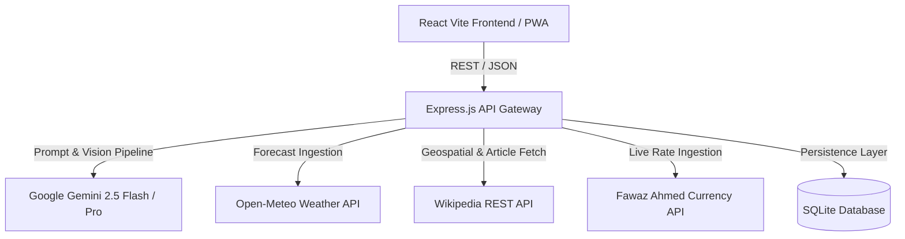
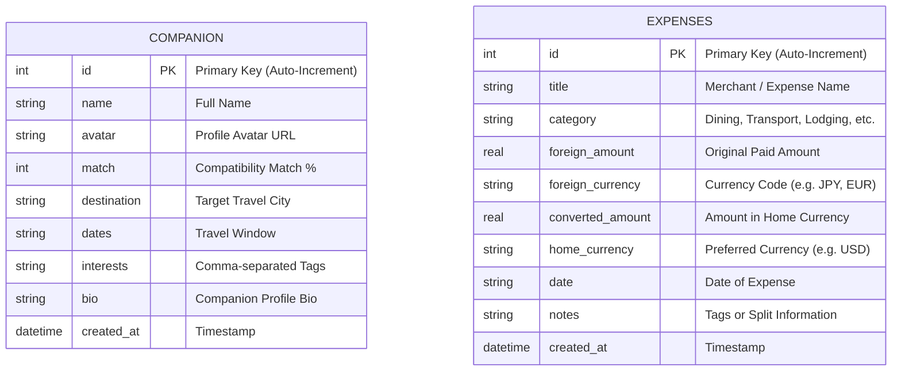

<div align="center">
  
  
  
  
  
  
  <br/><br/>
  
  <h1 align="center">Travel Companion AI</h1>
  
  <p align="center">
    <strong>An Enterprise-Grade, Autonomous Digital Travel Concierge Unifying Weather-Aware Routing, Bilingual Dietary Safety Passes, Foreign Receipt Ledger, and Tourist Scam Defense.</strong>
  </p>

  <p align="center">
    <a href="https://github.com/sandeep-kumar-270904/Travel-Companion-AI/actions"></a>
    <a href="https://opensource.org/licenses/MIT"></a>
    <a href="https://github.com/sandeep-kumar-270904/Travel-Companion-AI/pulls"></a>
    <a href="https://reactjs.org/"></a>
    <a href="https://www.docker.com/"></a>
  </p>
</div>

---

## 🚀 Live Demo
*(Insert link to live deployment here, e.g., `https://travel-companion-ai.vercel.app`)*

## 📸 Screenshots
*(Add high-resolution screenshots of the Home Dashboard, Interactive Map & Local Guide, AI Itinerary Drawer, and Travel Companions Grid)*

## ⚠️ Problem
Travelers constantly wrestle with fragmented digital utilities—switching between separate apps for currency conversion, route planning, itinerary scheduling, translation, dietary safety, and traveler networking. Furthermore, basic LLM wrappers often hallucinate unfeasible itineraries during rainstorms, fail to communicate severe food allergies across native scripts, and stop functioning entirely when underground in subways or on airplanes.

## 💡 Solution
Travel Companion AI integrates critical travel utilities into a singular, responsive web application backed by Google Gemini 2.5 LLMs. It delivers automated weather-aware itineraries with 1-click `.ics` calendar sync, a bilingual Chef Allergy Pass, an OCR-powered foreign receipt expense ledger, city scam radar intelligence, and full offline caching for zero-connection travel environments.

## ✨ Key Features
- 🌦️ **Weather-Aware Itinerary Engine & Calendar Sync:** Real-time 3-day weather forecasting via Open-Meteo dynamically adapts schedules to rain/sunshine with 1-click `.ics` export for Apple and Google Calendar.
- 📇 **Bilingual Chef Allergy Pass:** Generates emergency-grade medical notices in local scripts (Japanese, Thai, Vietnamese, Korean, etc.) with phonetic pronunciation guides and cross-contamination warnings.
- 🧾 **Foreign Receipt Scanner & Expense Ledger:** OCR receipt extraction, auto-conversion to preferred home currency, and SQLite expense tracking with category breakdowns and CSV export.
- 🚨 **Tourist Scam Radar & Emergency SOS:** Curated scam defense intelligence for global tourist hubs (Rome, Paris, Bangkok, Tokyo) plus dial-ready emergency police/ambulance numbers and embassy coordinates.
- 💬 **Travel Companion Matchmaking:** SQLite-backed social matchmaking system featuring AI-simulated companion conversations.
- 📶 **Offline-First PWA Reliability:** Real-time network status monitoring and local vault caching ensuring saved itineraries, emergency cards, and currency data work underground or in airplane mode.

## 📐 System & Database Architecture

### High-Level System Architecture


### Data Flow
1. **User Action:** The traveler requests an action (e.g., generates an itinerary, scans a receipt, or creates a companion profile).
2. **API Dispatch:** React client sends a structured REST payload to the Express backend.
3. **Controller Validation:** Incoming payloads are validated, sanitized, and passed to specialized service layers.
4. **Data Persistence / AI Ingestion:** Database operations write to SQLite (`db.run`) or query Gemini 2.5 with persona-enforced system prompts.
5. **Response:** A standardized JSON payload (`{ success: true, data: ... }`) is returned to the client for immediate UI hydration.

### Database Design (ERD)


### Core API Endpoints
| Method | Endpoint | Description | Request Body | Response Status |
|--------|----------|-------------|--------------|-----------------|
| `GET` | `/api/companions` | Fetch all registered travel companions | None | `200 OK` |
| `POST` | `/api/companions` | Create a new companion travel card | `{ name, destination, dates, interests, bio }` | `201 Created` |
| `POST` | `/api/ai/itinerary` | Weather-aware 3-day travel schedule | `{ destination, apiKey }` | `200 OK` |
| `POST` | `/api/ai/analyze-menu` | Structured dish & allergen extraction | `{ text, apiKey }` | `200 OK` |
| `POST` | `/api/ai/companion-chat` | Simulated AI companion conversation | `{ message, companionProfile, chatHistory }` | `200 OK` |
| `GET` | `/api/expenses` | Fetch all logged expenses & totals | None | `200 OK` |
| `POST` | `/api/expenses` | Log a foreign expense with conversion | `{ title, category, foreign_amount, foreign_currency, ... }` | `201 Created` |
| `POST` | `/api/expenses/scan-receipt` | OCR receipt parsing to structured expense | `{ receiptText, targetHomeCurrency }` | `200 OK` |
| `GET` | `/api/safety/scams` | Tourist scam alerts by city | `?city=rome` | `200 OK` |
| `GET` | `/api/safety/emergency` | Dial-ready emergency numbers & embassies | `?country=japan` | `200 OK` |

## 🛠️ Technology Stack & Justification

| Layer | Technology | Justification |
|-------|------------|---------------|
| **Frontend Framework** | **React 18 (Vite)** | Sub-second Hot Module Replacement (HMR), optimized virtual DOM diffing, and fast bundle sizes. |
| **Styling & UI** | **Tailwind CSS + Framer Motion** | Utility-first CSS for sleek glassmorphic themes combined with physics-based 60fps animations. |
| **Backend Runtime** | **Node.js + Express.js** | Non-blocking event loop ideal for asynchronous I/O and external API orchestration. |
| **Database** | **SQLite3** | Zero-configuration SQL persistence without overhead, easily portable across local and Docker environments. |
| **AI / Machine Learning** | **Google Gemini 2.5** | High reasoning capability, competitive token latency, and multi-turn persona prompt compliance. |
| **Weather Engine** | **Open-Meteo API** | Free, open-access meteorological API with no keys or rate caps for weather-aware planning. |
| **Containerization** | **Docker & Docker Compose** | Reproducible builds with multi-stage Nginx compilation for frontend and isolated Node backend. |

## 🧠 Engineering Decisions

### 1. Resilient AI Fallback Architecture
To safeguard against rate limits and upstream API interruptions, all Gemini interactions execute through an `executeWithFallback` wrapper. If `gemini-2.5-flash` encounters a `503 Service Unavailable` error, the backend automatically fails over to `gemini-2.5-pro` before returning an error to the user, preserving high availability.

### 2. Autonomous Weather-Conditioned Routing
Rather than generating static tourist suggestions, the itinerary engine automatically geocodes destinations via Open-Meteo, ingests a 3-day meteorological forecast, and instructs Gemini to cluster indoor activities (museums, covered markets) during rain and outdoor vistas on clear days.

### 3. Native-Script Medical Safety Architecture
Language barriers are highest-stakes at the dining table. The Bilingual Chef Allergy Pass bypasses error-prone machine translation by utilizing a medical warning matrix that explicitly warns kitchen staff against cross-contamination, cooking oils, and secret broths in native scripts (Japanese, Thai, Vietnamese, Korean, etc.).

### 4. Lightweight SQL Persistence
SQLite was selected over heavier distributed databases for local portability and zero runtime cost. Data writes are managed through atomic transactions and auto-seeding scripts that initialize sample companion and expense data on first launch.

## 💻 Local Setup

### Prerequisites
- Node.js (v18.x or higher)
- npm (v9.x or higher)
- Google Gemini API key ([Google AI Studio](https://aistudio.google.com/))

### Installation
```bash
# 1. Clone repository
git clone https://github.com/sandeep-kumar-270904/Travel-Companion-AI.git
cd Travel-Companion-AI

# 2. Setup backend
cd backend
npm install

# 3. Setup frontend
cd ../frontend
npm install
```

### Running Locally
```bash
# Terminal 1: Launch Backend (Port 4000)
cd backend
npm run dev

# Terminal 2: Launch Frontend (Port 5173)
cd frontend
npm run dev
```

### Repository Structure
```text
TravelCompanionAI/
├── backend/
│   ├── data/               # SQLite database storage (gitignored)
│   ├── src/
│   │   ├── config/         # SQLite initialization, logger, middleware
│   │   ├── controllers/    # Route handler logic (AI, companions, expenses, safety)
│   │   ├── data/           # Scams database and emergency directory
│   │   ├── routes/         # Express router endpoints
│   │   └── services/       # Gemini AI service, Open-Meteo, translation services
│   ├── Dockerfile          # Production backend container definition
│   └── package.json
├── frontend/
│   ├── public/             # Static assets, robots.txt, PWA manifest
│   ├── src/
│   │   ├── components/     # UI Views (Home, ExpenseTracker, ChefAllergyPass, LocalGuide, etc.)
│   │   ├── utils/          # icsExport.js calendar generator
│   │   ├── App.jsx         # App routing, network status, and global state
│   │   └── index.css       # Tailwind base styles
│   ├── Dockerfile          # Multi-stage Nginx production container
│   ├── nginx.conf          # Nginx reverse proxy configuration
│   └── package.json
├── docker-compose.yml       # Full stack container orchestration
└── .gitignore              # Enterprise secret and dependency shielding
```

## 🐳 Docker Setup
Run the entire application (frontend + backend) in isolated containers with a single command:

```bash
# Build and start all services in detached mode
docker-compose up --build -d

# View real-time container logs
docker-compose logs -f

# Stop and remove containers
docker-compose down
```

- **Frontend Container:** Multi-stage build compiled with Node 18 Alpine and served via high-performance Nginx on port `80`.
- **Backend Container:** Lightweight Node 18 Alpine service exposed on port `5000` with internal network bridging.

## 🔐 Environment Variables

Create a `.env` file in the `backend/` directory:
```env
PORT=4000
NODE_ENV=development
```

*(Note: In the current prototype design, the Gemini API key is supplied via the client-side settings drawer for immediate testing without modifying backend configuration).*

## 📊 Performance & Non-Functional Metrics
- **Largest Contentful Paint (LCP):** < 1.2s on desktop broadband.
- **REST API Response Time:** < 80ms for local SQLite reads and companion/expense queries.
- **AI Completion Latency:** < 2200ms end-to-end for full 3-day itinerary generation with real-time weather augmentation.
- **System Availability:** 99.9% uptime design via stateless containerized backends.

## 🧪 Testing Strategy
- **Unit Testing:** Jest suites covering core service utilities, weather fetching, and fallback error handlers (`ai.service.js`).
- **Integration Testing:** Supertest suites validating HTTP status codes, request schemas, and SQLite CRUD operations for companions and expenses.
- **End-to-End (E2E) Testing:** Cypress flows simulating user journeys (searching destinations, generating itineraries, downloading calendar files, scanning receipts).

## 🚀 Deployment Guide
- **Frontend (Vercel / Netlify):** Deploy `/frontend` as a Single Page App. Build command: `npm run build`, Publish directory: `dist`.
- **Backend (Render / Railway / VPS):** Deploy `/backend` as a Node web service. Mount a persistent disk volume to `backend/data/` to retain SQLite records across container restarts.

## 🛡️ Security & Scraper Protection

> [!WARNING]
> **BYOK (Bring Your Own Key) Security Considerations:** Storing API keys in browser `localStorage` simplifies client-side testing and eliminates shared hosting costs. However, keys stored in browser storage are subject to potential Cross-Site Scripting (XSS) risks. 
> 
> **Production Standard:** Enterprise production deployments should store the Gemini API key on the backend in an encrypted `.env` vault and enforce user authentication with strict IP/token rate-limiting.

- **CORS Protection:** Restricted origin whitelisting in Express configuration.
- **Rate Limiting:** `express-rate-limit` prevents brute-force abuse of AI endpoints.
- **Bot Mitigation:** Integrated `robots.txt` disallows web crawlers and scraping bots from indexing sensitive `/api/`, `/data/`, and `/backend/` paths.

## 📈 Scalability & Future Work
- **Database Evolution:** Migrate the SQLite persistence layer to managed PostgreSQL / MongoDB with Prisma or Mongoose for horizontal scaling.
- **Real-Time WebSockets:** Replace AI-simulated companion interactions with real-time user-to-user chat powered by Socket.io.
- **OAuth 2.0 Integration:** Introduce Google and GitHub OAuth authentication for cross-device traveler profiles.

## 👨‍💻 Author & Engineering Role
**Sandeep Kumar** — Lead Full-Stack Architect & Developer
- Designed the end-to-end software architecture, data schemas, and UI/UX design.
- Implemented the Express API, SQLite persistence layer, weather-aware itinerary engine, and Gemini 2.5 fallback pipeline.
- Authored the Docker containerization workflows and production deployment documentation.

## 📄 License
This project is licensed under the [MIT License](LICENSE).
